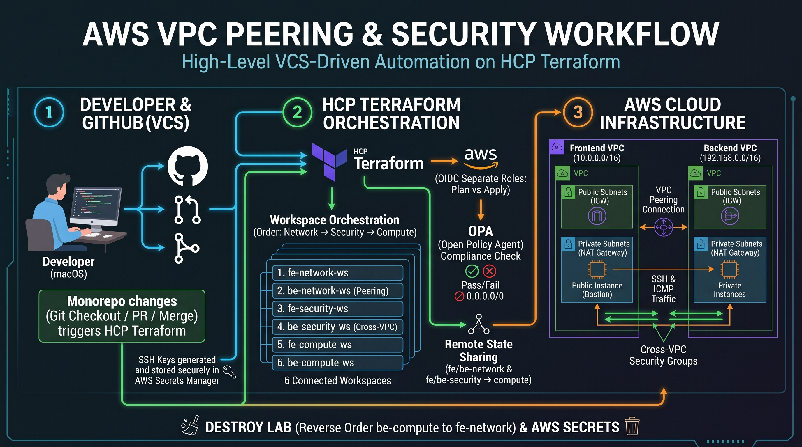

# AWS VPC Peering — VCS-Driven Workflow on HCP Terraform

[](docs/architecture.jpeg)

A frontend VPC (`10.0.0.0/16`) and a backend VPC (`192.168.0.0/16`) in `eu-west-1`, joined by VPC peering and deployed by HCP Terraform VCS-driven runs from GitHub.

- **AWS auth:** OIDC dynamic credentials configured in the HCP Terraform UI, with separate Plan (read-only) and Apply roles. No static access keys.
- **Security & compliance:** HashiCorp OPA (Open Policy Agent) policies prevent insecure configurations, for example denying `0.0.0.0/0` ingress rules.
- **SSH keys:** Generated on the Mac with `ssh-keygen` and stored in AWS Secrets Manager. Terraform reads the public key with a data source and the private key with an ephemeral resource, so the private key never appears in a plan, state file, run log, or this repository.
- **Organization:** `Sandar-Cloud-Lab` · **Project:** `VCS-OIDC`

---

## Table of Contents

1. [Architecture](#1-architecture)
2. [Workspaces](#2-workspaces-monorepo-one-folder--one-workspace)
3. [AWS Authentication (OIDC)](#3-aws-authentication-oidc--dynamic-credentials)
4. [Policy as Code (OPA)](#4-policy-as-code-opa)
5. [SSH Keys](#5-ssh-keys--mac--aws-secrets-manager)
6. [Change Workflow (GitOps)](#6-change-workflow-gitops)
7. [Test](#7-test)
8. [Destroy](#8-destroy-reverse-order)

---

## 1. Architecture

| | Frontend VPC `10.0.0.0/16` | Backend VPC `192.168.0.0/16` |
|---|---|---|
| **Public subnets** | `10.0.1-3.0/24` → IGW | `192.168.1-3.0/24` → IGW |
| **Private subnet01** | `10.0.253.0/24` → NAT | `192.168.253.0/24` → NAT |
| **Private subnet02** | `10.0.254.0/24` ↔ peering ↔ | `192.168.254.0/24` |
| **Private subnet03** | `10.0.255.0/24` ↔ peering ↔ | `192.168.255.0/24` |
| **Public instance01** | Amazon Linux 2023, EIP, httpd, bastion | same |
| **Private instance01–03** | Ubuntu 24.04 | Ubuntu 24.04 |

**Access path:** Mac → public instance (bastion) → private instance01 → private instance02/03.

**Peering traffic** (SSH + ICMP) is allowed only between private SG02 ↔ SG02 and SG03 ↔ SG03.

---

## 2. Workspaces (monorepo, one folder = one workspace)

| Order | Workspace | Working directory | Builds | Reads from |
|---|---|---|---|---|
| 1 | `fe-network-ws` | `fe-network` | Frontend VPC, subnets, IGW, NAT, route tables | — |
| 2 | `be-network-ws` | `be-network` | Backend VPC, subnets, IGW, NAT, route tables + **peering** | `fe-network` |
| 3 | `fe-security-ws` | `fe-security` | Frontend security groups | `fe-network` |
| 4 | `be-security-ws` | `be-security` | Backend security groups + **cross-VPC rules** (both sides) | `be-network`, `fe-security` |
| 5 | `fe-compute-ws` | `fe-compute` | Key pair, public + 3 private instances | `fe-network`, `fe-security` |
| 6 | `be-compute-ws` | `be-compute` | Key pair, public + 3 private instances | `be-network`, `be-security` |

> **Why peering lives in `be-network` and cross-VPC rules in `be-security`:**
> frontend and backend reference each other, so the frontend is created first and the backend adds the links. This avoids a circular dependency.

### Remote state sharing

Configure in the source workspace under **Settings → General → Remote state sharing**:

| Source workspace | Share with |
|---|---|
| `fe-network-ws` | `be-network-ws`, `fe-security-ws`, `fe-compute-ws` |
| `be-network-ws` | `be-security-ws`, `be-compute-ws` |
| `fe-security-ws` | `be-security-ws`, `fe-compute-ws` |
| `be-security-ws` | `be-compute-ws` |

---

## 3. AWS Authentication (OIDC — Dynamic Credentials)

OIDC is configured at the workspace level using the Dynamic Provider Credentials setup in the HCP Terraform UI.

- **Setup path:** Workspace → Variables → Add variable → Dynamic Provider Credential
- **Role usage:** Separate roles
- **Plan role:** `VCS-OIDC-Plan-Role` (ReadOnlyAccess + Secrets read policy)
- **Apply role:** `VCS-OIDC-Apply-Role` (AdministratorAccess + Secrets read policy)

---

## 4. Policy as Code (OPA)

An OPA policy set (`aws-compute-policy`) is attached to specific workspaces (for example `fe-security-ws`, `be-compute-ws`) to enforce security standards.

- **Rule `deny-ec2-sgp`:** Denies any `aws_security_group` or `aws_vpc_security_group_ingress_rule` that allows `0.0.0.0/0` in its `cidr_blocks` or `cidr_ipv4`.
- **Enforcement:** During the plan phase, an insecure rule fails the OPA check as **Hard Mandatory**, which prevents the apply phase from running.

---

## 5. SSH Keys — Mac → AWS Secrets Manager

Generate the keys and upload them:

```bash
bash scripts/create-ssh-keys.sh
```

| Secret | Terraform reads it as |
|---|---|
| `vcs-workflow/<tier>/ssh-public-key` | `data "aws_secretsmanager_secret_version"` → `aws_key_pair` |
| `vcs-workflow/<tier>/ssh-private-key` | `ephemeral "aws_secretsmanager_secret_version"` → provisioner connection only |

---

## 6. Change Workflow (GitOps)

```bash
# Example: create and push the frontend compute configuration
git checkout -b fe-compute
# edit files in fe-compute/
git add .
git commit -m "add fe-compute files"
git push --set-upstream origin fe-compute
```

1. Open a pull request.
2. The relevant workspace runs a **speculative plan**.
3. Review the plan and OPA checks.
4. Merge to `main`.
5. Confirm and apply in HCP Terraform.

---

## 7. Test

```bash
ssh-add ~/.ssh/vcs-workflow/frontend-ssh-key

# Check the web server on the public instance
curl http://<frontend_public_instance_public_ip>

# Jump through the bastion to private instance01
ssh -J ec2-user@<frontend_public_ip> ubuntu@<frontend_private_instance01_private_ip>

# From fe private-instance01 -> fe private-instance02 (agent forwarding: ssh -A)

# From fe private-instance02, test peering to the backend
ping <backend_private_instance02_private_ip>
```

---

## 8. Destroy (reverse order)

Destroy the workspaces in this order:

```
be-compute → fe-compute → be-security → fe-security → be-network → fe-network
```

Then delete the four secrets:

```bash
aws secretsmanager delete-secret --secret-id <secret-name> --force-delete-without-recovery
```

> **Cost note:** Each VPC has a NAT gateway, and every Elastic IP is billed hourly. Destroy the lab when finished.